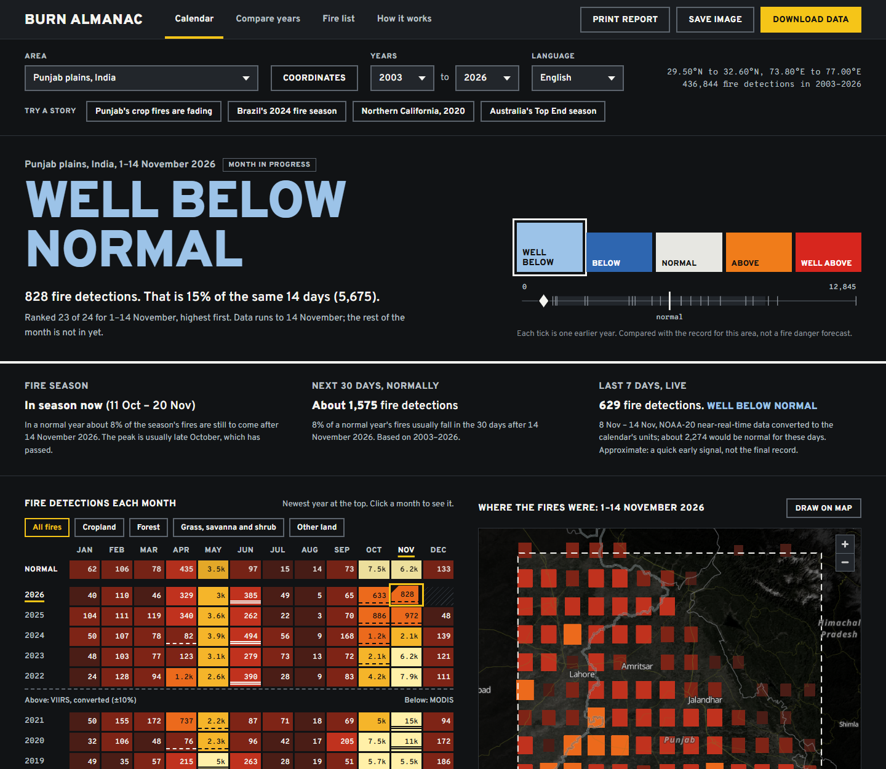
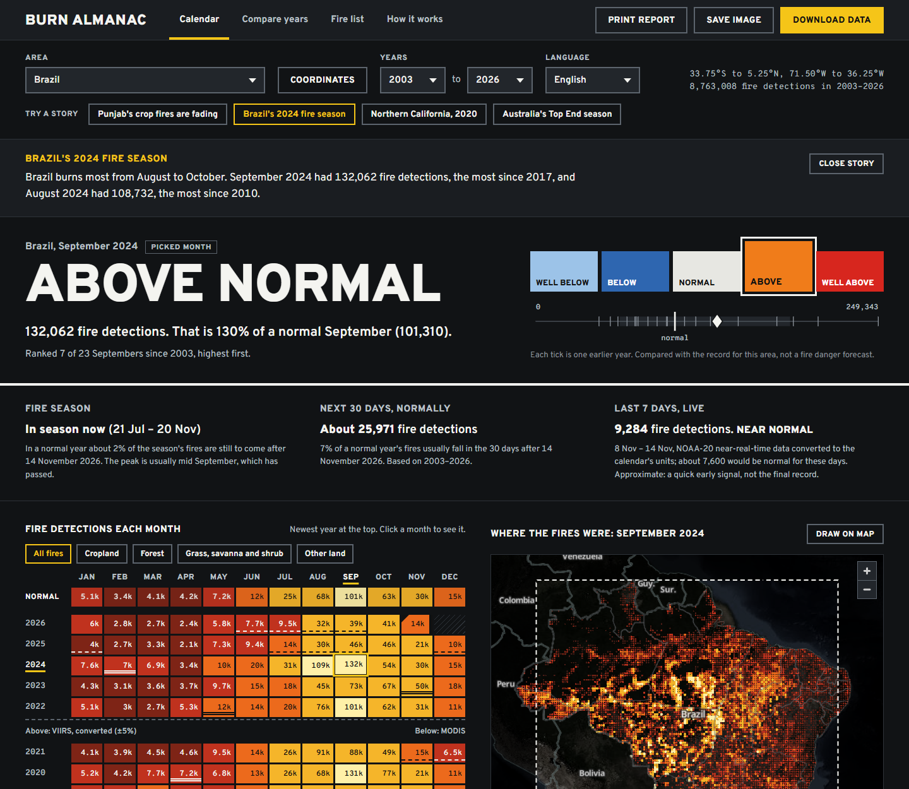
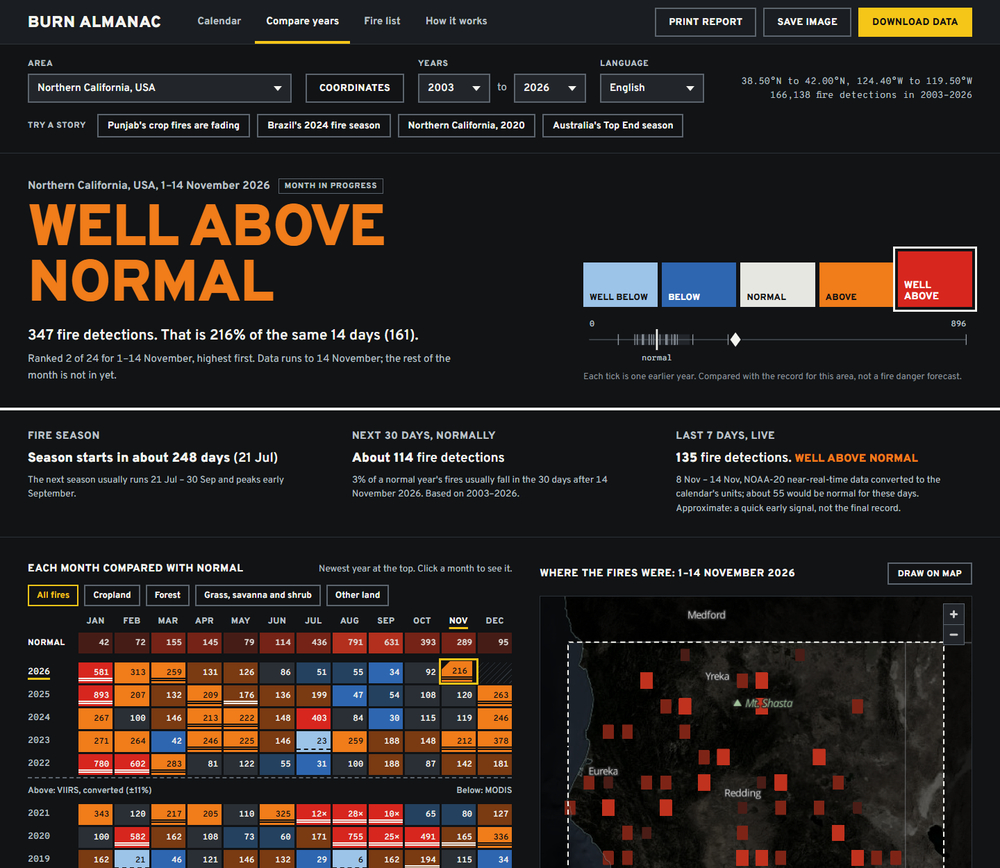
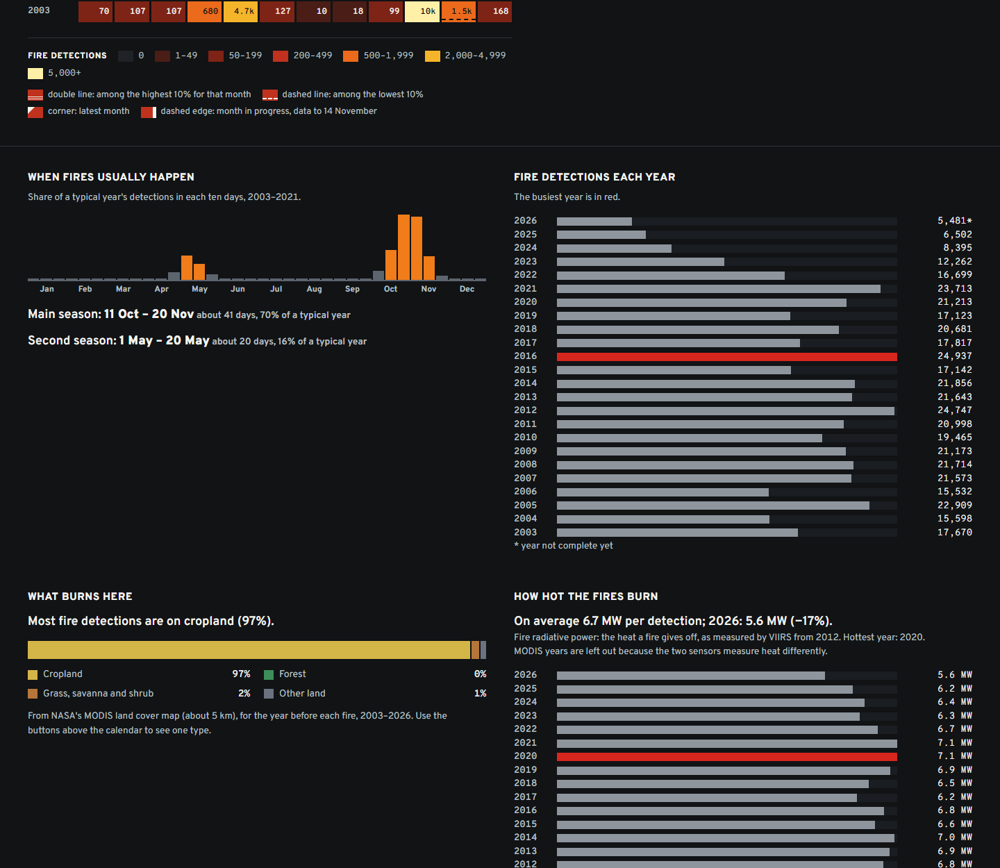
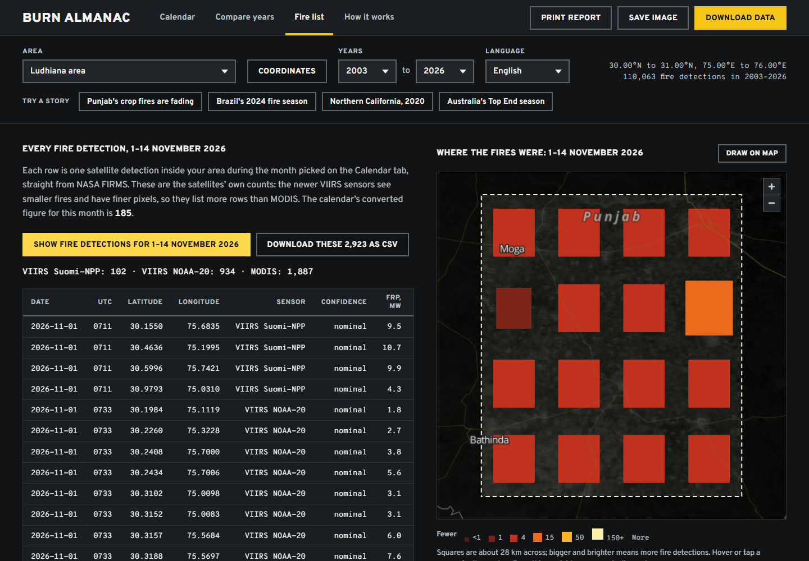

# Burn Almanac

**One satellite fire record from 2003 to today, for any place on Earth, in which the satellite no longer matters.**

Burn Almanac merges NASA's MODIS and VIIRS active-fire detections into a single, consistent record and shows it as a
burning activity calendar. Pick an area and it tells you, in plain words, whether this month's burning is normal, when
the fire season usually comes, and how every month and year since 2003 compares.

Built for the **NASA Space Apps Challenge 2026**, challenge *Harmonization of MODIS and VIIRS Hot Spots*.

| | |
|---|---|
| **Live app** | _Vercel link: to be added_ |
| **Backup (GitHub Pages)** | https://padmashri23.github.io/NASA_Space_App_Challenge_2026/ (everything except the live fire list and last-7-days check, which need a free NASA FIRMS key there) |
| **Data** | NASA FIRMS active fires (MODIS Collection 6.1, VIIRS 375 m Suomi-NPP and NOAA-20), 2000 to 14 November 2026 |



---

## The problem

Satellites have mapped active fires for more than two decades, but the record is split between two kinds of sensor:

- **MODIS** (Terra and Aqua, 2000 to now, being retired) sees the ground in pixels about 1 km across.
- **VIIRS** (Suomi-NPP from 2012, NOAA-20 from 2018) uses 375 m pixels, sees smaller and cooler fires, and has no
  morning pass.

For the same fires, VIIRS reports about **4.1 times as many detections** as MODIS. Joined as they come, the record
looks as if burning quadrupled the day the sensor changed. Fire managers cannot easily answer simple questions:
*Is this month unusual? When is our critical period? Which years were worst?*

## What Burn Almanac does

1. **Harmonizes the record.** 26 years of NASA FIRMS data (about 10 GB, more than 550 million detections) are
   converted into one unit, MODIS-equivalent fire detections, so 2003 and 2026 can be compared fairly.
2. **Answers the manager's question first.** A large plain verdict, *WELL BELOW NORMAL* to *WELL ABOVE NORMAL*, with the
   count, the percent of normal, and its rank among all years.
3. **Shows the whole history at a glance.** A calendar of every month since 2003 with a number in every cell, an
   accessible colour scale, and marks for unusually high or low months.

### Features

| | |
|---|---|
| **Any area** | Choose a region or one of 217 countries, type coordinates, or draw a box on the map (mouse or touch). |
| **Verdict** | This month against the same month in every earlier year. A month still in progress is compared with the same days in earlier years. |
| **Fire season outlook** | Whether the area is in its fire season now, how much of the season is usually still to come, and how many detections a normal next 30 days brings. |
| **Last 7 days, live** | NOAA-20 near-real-time detections from NASA FIRMS against what is normal for those days. |
| **Burning calendar** | Every month since 2003, with the satellite switch marked and its measured error shown. |
| **Compare years** | Each month as a percent of normal, the long-term trend (Mann–Kendall test), each year against a normal year, and the busiest months on record. |
| **What burns** | Each detection labelled cropland, forest, grass/savanna/shrub or other, from NASA's MODIS land cover map of the year before the fire. Filter the calendar by type. |
| **How hot** | Average fire radiative power per VIIRS detection, year by year. |
| **Map** | NASA Blue Marble with NASA GIBS borders and place names. The chosen area stays lit; squares grow and brighten with more fire, and show their count on hover. |
| **Fire list** | Every individual detection for an area and month, live from NASA FIRMS, downloadable as CSV. |
| **Downloads** | Monthly data as CSV, the calendar as an image, and a printable report. |
| **Stories** | One-click tours: Punjab's crop fires, Brazil's 2024 season, Northern California 2020, Australia's Top End. Every number in them is read from the data. |
| **Languages** | English, Hindi, Portuguese and Spanish for the main screens. |
| **Accessible** | Colour scales that work for colour-blind readers, a number in every calendar cell, keyboard navigation, phone layout. |

| | |
|---|---|
|  |  |
|  |  |

---

## How the harmonization works

The record is kept in one unit: the number of fire pixels the MODIS satellites would have recorded. VIIRS is brought
down to it (degrade, never invent):

1. **Clean up.** Keep vegetation fires only (FIRMS type 0), dropping gas flares, volcanoes and other static heat
   sources, and drop detections the satellites rate as low confidence. Near-real-time data has no type flag, so static
   sources are removed there by location.
2. **Match the pixel size.** Collapse VIIRS pixels to the distinct ~1 km cells that burned on each date, so one fire
   front is not counted several times. The VIIRS/MODIS ratio falls from 4.1 to 2.7.
3. **Calibrate.** For every 1° cell, separately for day and night, measure MODIS pixels per VIIRS 1 km cell over the
   years both satellites flew on stable orbits (2012–2021 for Suomi-NPP, 2018–2021 for NOAA-20). Cells with little
   data borrow strength from their 5° neighbourhood, then from the global ratio. Worldwide the factor is 0.42 by day
   and 0.19 by night.
4. **Join.** MODIS as observed up to 2021; the VIIRS-based equivalent from 2022, averaged over the VIIRS satellites
   available each month.

### Why the record switches to VIIRS in 2022

A sensor is only comparable with its own past while it passes at the same time of day. Measured from the fire records
themselves, the MODIS orbits have drifted while VIIRS has held steady:

| Mean local time of daytime detections | 2021 | 2025 | 2026 |
|---|---|---|---|
| Aqua (MODIS) | 13:33 | 14:42 | 15:24 |
| Terra (MODIS) | 10:35 | 09:34 | 09:10 |
| Suomi-NPP (VIIRS) | 13:25 | 13:26 | 13:34 |
| NOAA-20 (VIIRS) | 13:24 | 13:23 | 13:29 |

Suomi-NPP stopped delivering data on 2 November 2026; the record continues on NOAA-20.

### How well it holds

Each calibration year was hidden in turn, predicted from the other years, and compared with what MODIS recorded.
Typical (median) error:

| Scale | VIIRS as delivered | One global factor | Burn Almanac, Suomi-NPP | Burn Almanac, NOAA-20 |
|---|---|---|---|---|
| Whole world, one year | 308% | 2.0% | **1.0%** | **2.0%** |
| Whole world, one month | 314% | 8.4% | **4.6%** | **5.2%** |
| A 5° region, one month | 296% | 29.2% | **14.8%** | **15.8%** |
| A 1° cell, one month | 278% | 31.1% | **18.8%** | **19.9%** |

Overall bias: −0.3% (Suomi-NPP), −1.0% (NOAA-20). The app shows these figures, and the typical difference at the seam
for whatever area is selected.

## What makes it different

- **The merge is tested, not assumed.** Hold-out validation at four scales, published in the app.
- **The sensor switch is justified by evidence.** Satellite overpass drift measured from the fire data itself.
- **It keeps working as satellites retire.** Suomi-NPP has stopped; NOAA-20 carries the record on.
- **A month in progress is compared fairly.** 1–14 November is compared with 1–14 November in other years, not with
  whole months.
- **It looks ahead.** The usual fire season and the next 30 days, from 24 years of timing.
- **It is for everyone.** Plain-language verdicts, four languages, accessible colours, and every number on screen.

---

## Data sources

| Data | Source |
|---|---|
| Active fires 2000–2025 | NASA FIRMS standard-processing country archives (MODIS C6.1, VIIRS 375 m Suomi-NPP and NOAA-20) |
| Active fires 2026 | NASA FIRMS area API: standard processing where released, near-real-time after |
| Fire list and last 7 days | NASA FIRMS area API, live |
| Land cover | NASA MODIS land cover type (IGBP), yearly 2001–2024, via NASA GIBS |
| Map background | NASA Blue Marble shaded relief, via NASA GIBS |
| Map borders and place names | NASA GIBS reference layers (built from OpenStreetMap data, © OpenStreetMap contributors) |
| Fallback outline map | Natural Earth (public domain), shown only if NASA GIBS does not load |

A fire detection is one satellite pixel where active burning was seen as the satellite passed. It is not a count of
separate fires and not burned area.

## How it is built

```
NASA FIRMS archives + API ──> pipeline/ (Python, DuckDB)
                               ingest ─> 0.25° grid ─> calibration and hold-out validation ─> land cover, fire strength
                               └─> web/public/data/  static tiles (433 files, 47 MB), country masks, summary
                                         │
                                         ▼
                               web/ (Next.js, React, TypeScript, MapLibre GL)
                               sums the tiles for any area in the browser;
                               small server routes call NASA FIRMS for the fire list and the live check
```

The harmonized record ships with the app as static files, so the calendar, verdict, outlook and map need no database
or server.

## Run it yourself

Requires Node.js 20 or later.

```bash
cd web
npm install
cp .env.local.example .env.local   # then paste a free NASA FIRMS key: https://firms.modaps.eosdis.nasa.gov/api/map_key/
npm run dev                        # http://localhost:3000
```

Without a key, everything works except the fire list and the last-7-days check.

## Rebuild the data

Needs Python 3.12 with `duckdb`, `numpy`, `pyarrow` and `pillow`, about 25 GB of disk, and a few hours.

```bash
bash pipeline/download.sh           # FIRMS country archives 2000–2025 (about 10 GB)
python pipeline/ingest.py           # zip -> Parquet
python pipeline/fetch_recent.py     # the current year from the FIRMS API (needs the key; rate-limited, about an hour)
python pipeline/aggregate.py        # 0.25° grid by month and day/night
python pipeline/harmonize.py        # calibration, hold-out validation, monthly record
python pipeline/overpass.py         # satellite overpass times by year
python pipeline/landcover.py        # NASA land cover per detection, fire strength
python pipeline/export_web.py       # tiles and summary for the app
```

## Deploy

- **Vercel (recommended):** import this repository, set the root directory to `web`, and add the environment variable
  `FIRMS_MAP_KEY`. Every feature works and the key stays on the server.
- **GitHub Pages (static):** `cd web && node scripts/build-pages.mjs` builds `web/out`, which is published to the
  `gh-pages` branch. There is no server, so the fire list and the live check ask the visitor for their own free key.

## Repository layout

```
pipeline/          data pipeline (download, ingest, harmonize, validate, export)
web/               the web app (Next.js)
  src/components/  board, calendar, map, outlook, panels, fire list, method page
  src/lib/         data loading, statistics, outlook, NASA FIRMS calls, exports, languages
  public/data/     the harmonized record as static tiles
docs/screenshots/  images used in this README
```

## Limits

- The grid is 0.25° (about 28 km at the equator); very small areas are read off neighbouring land too.
- Before July 2002 only Terra was flying, so 2000–2002 run low; the default period starts in 2003.
- Cloud, smoke and the gaps between passes hide fires from every sensor; harmonizing cannot recover what neither saw.
- Near-real-time counts can still change slightly when NASA reprocesses them.
- The live 7-day check uses the global calibration factor, so it is an early signal rather than the final record.
- Land cover comes from 500 m MODIS maps resampled to about 5 km.
- Translations cover the main screens; the method page and story texts are in English.

## Team

**Padmashri S** ([@padmashri23](https://github.com/padmashri23))

## Acknowledgements

NASA FIRMS (Fire Information for Resource Management System), NASA GIBS (Global Imagery Browse Services), the MODIS and
VIIRS science teams, and the NASA Space Apps Challenge. Map data © OpenStreetMap contributors; outline map from
Natural Earth.
